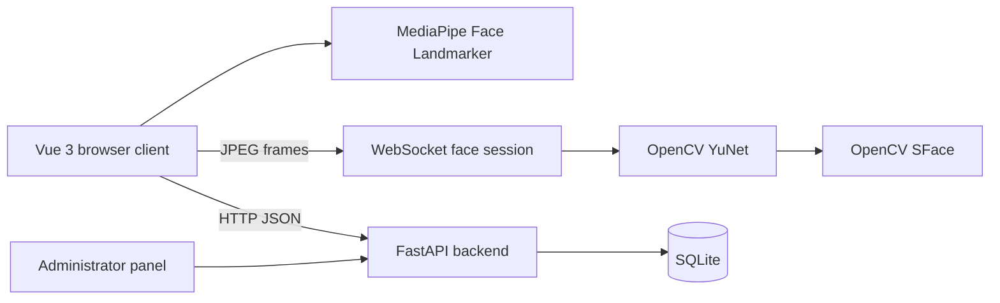

# FaceSignUp

FaceSignUp is a self-hosted face registration and sign-in application built
with Vue 3, FastAPI, MediaPipe, OpenCV YuNet, and OpenCV SFace. It provides a
single `/faceScanner` entry point, a password fallback, account recovery, voice
guidance, and an administrator panel.

> [!IMPORTANT]
> This is an MVP, not a certified identity-proofing or presentation-attack
> detection product. The custom liveness checks can be defeated by modified
> clients, virtual cameras, injected video, or sophisticated presentation
> attacks. Do not use it as the only authentication factor for financial,
> government, healthcare, or other high-risk systems.

## Features

- Face registration and face-based sign-in.
- Client-bound, short-lived face candidate and enrollment tokens.
- Server-controlled ambient/red/green/blue/white screen-light challenge.
- Accessible movement challenge: blink both eyes, open the mouth briefly, or
  turn the head gently to one side.
- Live facial-landmark overlay and prominent center-screen guidance.
- Face consistency checks across three independently captured embeddings.
- Up to three ranked account candidates after a face match.
- Face match followed by password verification.
- One user-authored password-recovery question.
- Name-and-password fallback when a user does not want to use the face scanner.
- English, Simplified Chinese, Russian, Spanish, French, German, Korean,
  Japanese, and Uzbek UI.
- Browser-language detection and device speech synthesis.
- Encrypted face embeddings and encrypted profile thumbnails.
- Argon2id password and recovery-answer hashes.
- SQLite storage with WAL mode.
- Administrator user management, roles, profile-photo viewing, and deletion.
- Account self-deletion and biometric-consent tracking.
- Docker/Caddy deployment and hardened systemd/Nginx templates.

## Architecture



See [Architecture](docs/ARCHITECTURE.md) for the scan state machine, token
lifecycle, data model, and authentication flows.

## Scan and authentication flow

1. The browser opens the camera and loads MediaPipe locally.
2. The backend creates a random movement challenge.
3. The browser streams JPEG frames over a same-origin WebSocket.
4. MediaPipe evaluates the requested movement while the backend measures face
   quality and captures a reference embedding.
5. The backend does not start the light challenge until the instruction has
   finished speaking and the browser sends `lighting_ready`.
6. The backend controls the light schedule and evaluates the reflected colors.
7. YuNet and SFace produce a face embedding, and the backend verifies that the
   same face was present during all stages.
8. The backend compares the embedding against enrolled accounts and returns up
   to three candidates with short-lived tokens.
9. The selected account must still provide its password.
10. A forgotten password can be reset by answering the one question chosen
    during registration.

The raw stream is processed in memory. Registration stores one encrypted
256x256 profile thumbnail for administrator account management.

## Quick start

### Requirements

- Node.js 24 or newer
- Python 3.13 or newer
- A browser with camera support
- A local webcam

### Windows

```powershell
python -m venv .venv
.\.venv\Scripts\python.exe -m pip install -r backend\requirements-dev.txt
npm ci
npm run dev
```

Open <http://127.0.0.1:5173/faceScanner>.

`npm ci` regenerates `public/mediapipe/wasm/` from the installed MediaPipe
package. That generated runtime is intentionally excluded from Git.

### Linux or macOS

```bash
python3 -m venv .venv
.venv/bin/python -m pip install -r backend/requirements-dev.txt
npm ci
npm run dev
```

The development command starts:

- Vite on `127.0.0.1:5173`
- FastAPI on `127.0.0.1:8100`

## Production-style local run

```powershell
$env:VITE_BASE = "/"
npm run build
npm start
```

Open <http://127.0.0.1:8100/faceScanner>. FastAPI serves the compiled frontend
and the `/api` and `/ws` routes.

For a subpath deployment:

```powershell
$env:VITE_BASE = "/face-signup/"
npm run build
```

## Administrator

Default first-login administrator:

```text
Name: admin
Password: admin123
```

The administrator is forced to change this password before management APIs are
unlocked. The admin panel is available at `/admin` on the same host as the
application.

Administrators can:

- View users and roles.
- View encrypted profile thumbnails through a protected endpoint.
- Promote or demote users while preserving at least one administrator.
- Delete other accounts.

The default password is for initial bootstrap only. Never expose a production
administrator account with this password.

## Data storage

- Default database: `data/facesignup.db`
- Development encryption key: `data/embedding.key`
- Production encryption key: `FACESIGNUP_EMBEDDING_KEY`

Stored data includes:

- User name and role
- Argon2id password hash
- One security question and Argon2id answer hash
- Fernet-encrypted SFace embedding
- Fernet-encrypted profile thumbnail
- Hashed session tokens
- Consent and Terms versions

No email address is collected. Raw camera frames are not intentionally written
to disk. See [Privacy](docs/PRIVACY.md).

## Security summary

- HTTPS is required outside localhost.
- Authentication cookies are HTTP-only and `SameSite=Strict`.
- Production cookies use the `Secure` and `__Host-` prefixes.
- State-changing API requests require a trusted `Origin`.
- API responses use `no-store`.
- Face and enrollment tokens expire and are bound to the requesting client.
- WebSocket sessions are origin- and client-bound.
- Session tokens are stored as SHA-256 hashes.
- Production API documentation endpoints are disabled.
- Rate limits cover face sessions, logins, registration, recovery, and deletion.
- Model integrity hashes are checked by the production readiness script.
- CSP, HSTS, frame denial, MIME sniffing protection, and referrer restrictions
  are enabled.

See [Security](docs/SECURITY.md) and
[Production Readiness](docs/DEPLOYMENT.md) before accepting real users.

## Testing

```powershell
npm test
npm run check:locales
$env:VITE_BASE = "/"
npm run build
.\.venv\Scripts\python.exe -m ruff check backend scripts
.\.venv\Scripts\python.exe -m ruff format --check backend scripts
```

Dependency checks:

```powershell
npm audit --omit=dev
pip-audit -r backend\requirements.txt
```

## Docker

```bash
python scripts/init_production.py --domain faces.example.com
set -a
. ./.env
set +a
python scripts/check_production.py
docker compose up -d --build
```

Caddy terminates TLS, while the application runs read-only as a non-root user
with all Linux capabilities dropped.

## Documentation

- [Architecture](docs/ARCHITECTURE.md)
- [API Reference](docs/API_REFERENCE.md)
- [Configuration](docs/CONFIGURATION.md)
- [Development](docs/DEVELOPMENT.md)
- [Deployment](docs/DEPLOYMENT.md)
- [Administrator Guide](docs/ADMIN_GUIDE.md)
- [Operations](docs/OPERATIONS.md)
- [Security](docs/SECURITY.md)
- [Privacy](docs/PRIVACY.md)
- [Troubleshooting](docs/TROUBLESHOOTING.md)
- [Model Manifest](MODEL_MANIFEST.md)
- [Terms of Service](TERMS_OF_SERVICE.md)
- [Third-Party Notices](THIRD_PARTY_NOTICES.md)

## Known limitations

- Custom liveness is not certified presentation-attack detection.
- Browser-reported action evidence can be forged by a modified client.
- A single security question is weaker than a passkey or recovery code.
- In-memory rate limiting and SQLite target a single application instance.
- Showing account names before final authentication can reveal enrolled names.
- Child consent, biometric privacy, and local-language legal requirements need
  review for the deployment jurisdiction.
- Face recognition accuracy and fairness require testing with representative
  local users and cameras.

For high-risk deployments, replace the liveness decision with a certified
provider such as AWS Face Liveness, Azure Face Liveness, FaceTec, or iProov.

## Contributing

Read [CONTRIBUTING.md](CONTRIBUTING.md). Report vulnerabilities using the
repository's private GitHub Security Advisory feature, not a public issue.

## License

FaceSignUp source code is available under the [MIT License](LICENSE). Third-party
software and model assets remain subject to their own licenses. See
[THIRD_PARTY_NOTICES.md](THIRD_PARTY_NOTICES.md).
