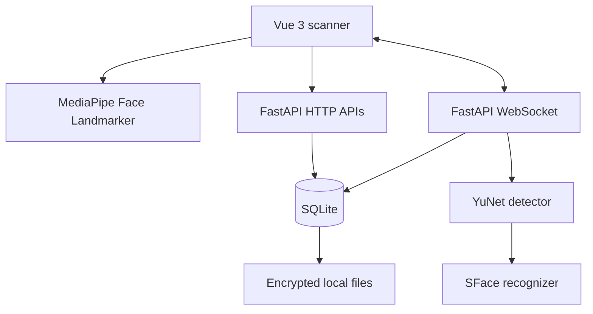
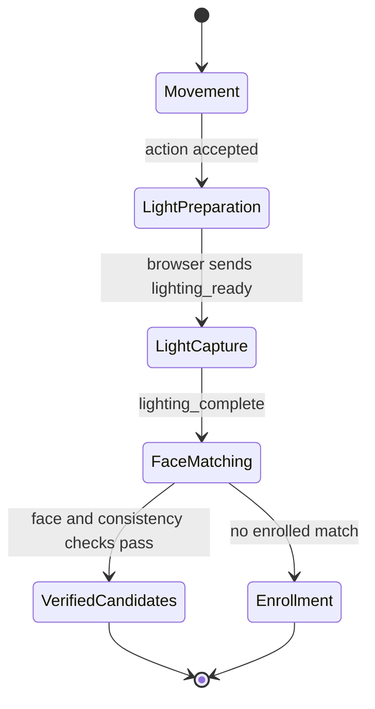
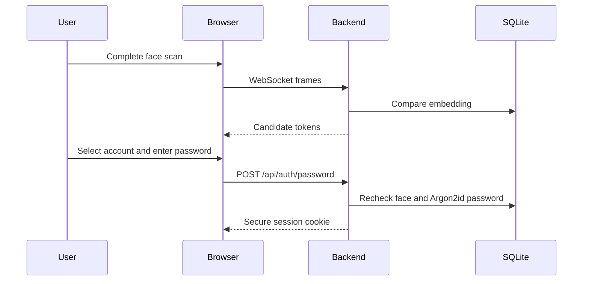

# Architecture

## Overview

FaceSignUp consists of a Vue 3 browser application and a Python FastAPI backend.
The browser performs local face-landmark and expression detection, streams
JPEG frames to the backend, and renders server-controlled scan guidance. The
backend owns the scan state, light schedule, face embeddings, matching,
password verification, recovery, sessions, and administration.



## Runtime topology

### Frontend

- Vue 3 single-page application.
- Vite development server with `/api` and `/ws` proxies.
- Production bundle served by FastAPI or a reverse proxy.
- MediaPipe JavaScript and WASM assets are local; no runtime CDN is required.
- Browser speech synthesis provides spoken guidance without a remote service.

### Backend

- FastAPI served by Uvicorn.
- One worker by default because active scan state and rate counters are
  in-process.
- SQLite in WAL mode for persistent state.
- OpenCV DNN models for YuNet face detection and SFace recognition.
- Fernet authenticated encryption for biometric templates and profile photos.
- Argon2id for password and recovery-answer hashes.

## Source layout

```text
backend/
  app.py             HTTP, WebSocket, scan state, API validation
  config.py          Environment-backed settings
  db.py              SQLite schema, migrations, persistence
  face_engine.py     YuNet/SFace, quality, lighting, profile crops
  security.py        Argon2id, Fernet, tokens, password policy
  tests/             Backend regression tests
src/
  App.vue            Scanner, registration, recovery, login UI
  AdminPanel.vue     Administrator UI
  locales.js         Nine UI dictionaries
  terms.js           Nine localized Terms versions
  styles.css         Main UI styling
  admin.css          Admin UI styling
public/
  models/            MediaPipe browser model
  mediapipe/wasm/    Local MediaPipe runtime
deploy/
  Docker/systemd/Nginx deployment templates
scripts/
  Setup, readiness, backup, diagnostics, locale checks
```

## Scan state machine

Each scan is a server-side `ScanSession`.



### Step 1: movement

- The backend randomly selects `blink_both`, `open_mouth`, or `turn_head`.
- The browser detects landmarks and blendshapes using MediaPipe.
- The backend requires a matching action event with sufficient confidence.
- A usable reference embedding must already have been captured.
- The event is evidence, not a security proof. A modified client can forge it.

### Step 2: screen light

- The backend sends the light schedule after the movement passes.
- The browser pauses image upload while the instruction is spoken.
- The browser sends `lighting_ready` only after speech completes.
- The backend starts its authoritative timer on `lighting_ready`.
- Frames are grouped into ambient, red, green, blue, and white phases.
- The backend evaluates brightness and color response in the face region.
- A production deployment should keep movement-only fallback disabled.

### Step 3: identity embedding

- YuNet finds the face.
- SFace aligns the face and produces a normalized embedding.
- The backend compares the movement, lighting, and final embeddings.
- If the three embeddings are inconsistent, the scan fails.
- The backend compares the final embedding with enrolled templates.

## Candidate selection

The backend ranks distinct users by cosine similarity and returns at most three
candidates above `CANDIDATE_THRESHOLD`. A result is only offered when the top
candidate also exceeds `MATCH_THRESHOLD`.

Each candidate receives an opaque token containing:

- User ID
- Scan embedding
- Expiry timestamp
- Attempt count
- Requesting client address

The browser never receives a session until the selected account password is
verified.

## Authentication flows

### Face plus password



### Forgotten password

1. The user selects **Forgot password**.
2. The backend returns the account's single stored question.
3. The user supplies the answer and a new password.
4. The backend verifies the Argon2id answer hash.
5. The backend replaces the password hash and invalidates existing sessions.

### Name and password

The fallback endpoint verifies the unique display name and Argon2id password.
It does not require a face scan.

## Token and session lifecycle

| Token | Lifetime | Storage | Client-bound | Single-use |
| --- | ---: | --- | --- | --- |
| Face scan session | 180 seconds | Memory | Yes | Yes |
| Face candidate token | 90 seconds | Memory | Yes | Yes |
| Enrollment ticket | 15 minutes | Memory | Yes | Yes |
| Auth session | 12 hours | SQLite hash | Cookie-based | No |

Auth session cookies are HTTP-only and `SameSite=Strict`. Production cookies are
Secure and use `__Host-fs_session`.

## Data model

### `users`

- UUID
- Internal non-email key
- Unique case-insensitive display name
- Password hash
- Role and mandatory-password-change flag
- Encrypted profile thumbnail
- Consent, Terms, and creation metadata

### `face_embeddings`

- User foreign key
- Fernet-encrypted embedding payload
- Model version
- Creation time

### `security_answers`

- User foreign key
- User-authored question
- Argon2id answer hash

### `auth_sessions`

- SHA-256 session-token hash
- User foreign key
- Expiry and creation timestamps

## Concurrency and resource controls

- One face task can run at a time per process.
- OpenCV threading is reduced to control memory and CPU use.
- Frame size, request size, WebSocket command size, and sample counts are
  bounded.
- Candidate, enrollment, scan, and rate data are protected by an in-process
  lock.
- Expired temporary tokens are pruned.
- The rate-limit store is capped and evicts the oldest client bucket.

These controls assume a single backend process. A multi-instance deployment
requires shared scan state, shared rate limiting, and PostgreSQL.

## Fail-closed behavior

- Missing encryption keys stop production startup.
- Production requires HTTPS origins and trusted hosts.
- Face enrollment tokens are not consumed by failed validation.
- Authentication tokens are discarded after expiry or client mismatch.
- Multiple faces, missing faces, low-quality faces, inconsistent embeddings, and
  failed lighting checks stop the scan.

## Extension points

- Add a certified liveness provider by replacing the movement/light decision.
- Use PostgreSQL for multiple application instances.
- Use Redis for shared rate limiting and temporary token storage.
- Add WebAuthn/passkeys as a stronger recovery or second factor.
- Add encrypted object storage for profile assets.
